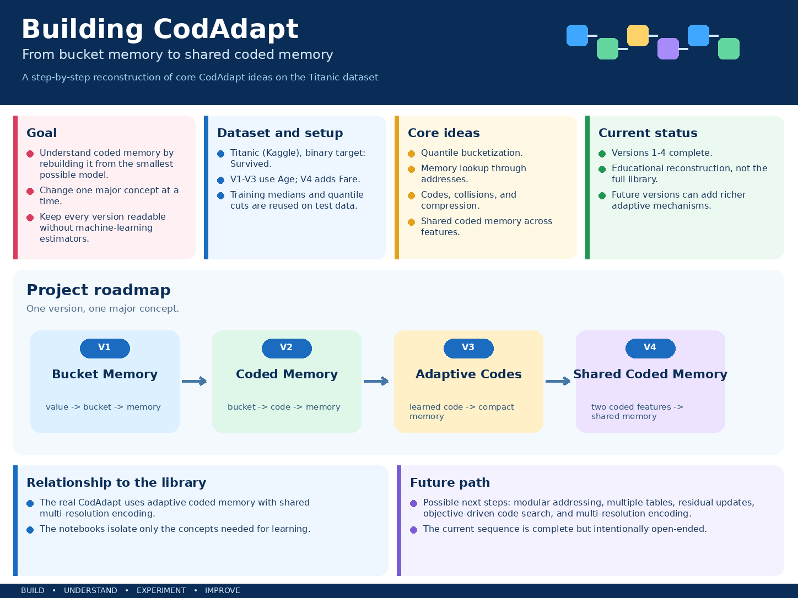

# Building CodAdapt


A progressive educational project that rebuilds selected ideas behind **CodAdapt from scratch**, starting from a one-feature bucket-memory model and evolving step by step toward coded memory, adaptive codes, collisions and shared coded memory across multiple features.

The project uses the **Kaggle Titanic dataset** as a constant practical laboratory. Keeping the same dataset across all versions makes every architectural change easy to inspect and compare.

The implementation intentionally avoids using the CodAdapt package itself. Bucketization, memory construction, code assignment, compact addressing and prediction are implemented directly with NumPy and pandas so that the mechanics remain visible.

CodAdapt is also an experimental tabular machine-learning library I am developing separately:

- [CodAdapt on GitHub](https://github.com/lucalullo/codadapt)
- [CodAdapt on PyPI](https://pypi.org/project/codadapt/)

This repository is a **simplified educational reconstruction**, not the full production implementation of the library.

## Project roadmap

The project follows one main principle:

> **One version, one major concept.**

Version 1 introduces **Bucket Memory**:

1. use `Age` as the only input feature;
2. fill missing ages with the training median;
3. divide continuous values into four quantile buckets;
4. learn the average target value for each bucket;
5. store the learned values in a small memory array;
6. use the bucket index directly as the memory address;
7. convert memory values into binary Titanic predictions with a `0.5` threshold.

Version 2 adds **Coded Memory** while preserving the rest of the model:

1. keep the same `Age` preprocessing and bucketization;
2. introduce an explicit code for every bucket;
3. map each bucket to a memory address through its code;
4. read predictions from `memory[address]` instead of `memory[bucket]`;
5. keep the initial code mapping one-to-one so that only the addressing abstraction changes.

Version 3 adds **Adaptive Codes** and compact memory:

1. compute the target mean for every `Age` bucket;
2. compare each bucket mean with the global target mean;
3. assign a simple learned binary code to every bucket;
4. reduce the memory from four cells to two;
5. allow multiple buckets to share the same memory address;
6. make collisions an explicit part of the model.

Version 4 adds **Shared Coded Memory** across multiple features:

1. use both `Age` and `Fare`;
2. discretize each feature independently into four buckets;
3. learn simple binary codes for the buckets of each feature;
4. combine the two feature codes into one shared address;
5. learn a four-cell shared memory;
6. use the shared address to make predictions.

Each version preserves the previous implementation as much as possible so that the effect of the new concept can be studied in isolation.

Versions 1-4 form the current completed learning sequence. The project remains intentionally open to future versions.



## Current capabilities

The current Version 4 implementation can:

- load the Titanic training and test datasets;
- use numerical features directly with NumPy and pandas;
- fill numerical missing values with medians learned only from the training set;
- discretize continuous features with quantile-based bucket boundaries;
- reuse the same learned medians and bucket boundaries at prediction time;
- compute target means for individual buckets;
- assign simple data-dependent binary codes to buckets;
- separate bucket identity from memory address;
- compress several bucket states into fewer memory cells;
- create intentional collisions between discrete states;
- combine codes from multiple features into a shared memory address;
- learn one target value per shared-memory cell;
- read predictions through coded memory lookup;
- convert continuous memory values into binary classes with a threshold of `0.5`;
- generate Kaggle submission files for the Titanic competition.

The current Version 4 shared-address rule is:

```text
address = age_code + 2 * fare_code
```

With binary codes for both features, this produces four possible shared-memory addresses.

## Current architecture

```text
Titanic Data
    ↓
Training Medians
Age / Fare
    ↓
Quantile Bucketization
4 buckets per feature
    ↓
Bucket Target Means
    ↓
Simple Adaptive Codes
0 or 1 per bucket
    ↓
Feature Codes
Age code + Fare code
    ↓
Shared Address
age_code + 2 × fare_code
    ↓
Shared Memory
4 cells
    ↓
Memory Lookup
    ↓
Continuous Prediction
    ↓
Threshold 0.5
    ↓
Binary Titanic Prediction
    ↓
Kaggle Submission
```

The key transition in Version 4 is that multiple independently discretized features contribute codes to the same shared memory address. This makes it possible to represent a compact interaction without allocating one separate memory cell for every raw pair of feature buckets.

## Project versions

| Version | Main concept | Status |
|---|---|---|
| Version 1 | Bucket Memory | Complete |
| Version 2 | Coded Memory | Complete |
| Version 3 | Adaptive Codes | Complete |
| Version 4 | Shared Coded Memory | Complete |

## Version 1 - Bucket Memory

Version 1 establishes the smallest complete learning loop.

`Age` is the only input feature. Missing values are filled with the median learned from the training set, then the feature is divided into four quantile buckets.

The learned cut points in the saved notebook are approximately:

```text
[22, 28, 35]
```

Each bucket stores the average target value of the samples assigned to it:

```text
memory = [0.4265, 0.4060, 0.3354, 0.4000]
```

Prediction is a direct lookup:

```text
Age → bucket → memory[bucket] → prediction
```

All four learned memory values are below `0.5`, so this intentionally simple one-feature version predicts class `0` for every Titanic test row when the default classification threshold is used.


## Version 2 - Coded Memory

Version 2 keeps the same bucketization and memory values but separates the bucket from the memory address.

The initial mapping is deliberately simple:

```text
codes = [0, 1, 2, 3]
```

The prediction path becomes:

```text
Age → bucket → code → address → memory[address] → prediction
```

Because the codes are initially identical to the bucket indices, Version 2 intentionally behaves like Version 1. The new concept is architectural: later versions can change memory addresses without changing the bucketization itself.


## Version 3 - Adaptive Codes

Version 3 makes the codes data-dependent and reduces the memory from four cells to two.

For every bucket, the model computes the local target mean and compares it with the global target mean. The bucket receives code `1` when its mean is greater than or equal to the global mean, otherwise code `0`.

The saved notebook learns:

```text
codes = [1, 1, 0, 1]
```

and the compact memory becomes:

```text
memory = [0.3354, 0.4108]
```

Several buckets therefore share the same memory cell. These collisions are intentional and demonstrate how coded addressing can compress a larger discrete state space into a smaller memory.

The code-learning rule in this notebook is intentionally simple and educational. It is **not** the optimization procedure used by the production CodAdapt library.


## Version 4 - Shared Coded Memory

Version 4 extends the model to two numerical features:

```text
Age
Fare
```

Each feature is independently bucketized and assigned simple binary codes. The two feature codes are then combined into one shared address:

```text
address = age_code + 2 * fare_code
```

The learned shared memory in the saved notebook is approximately:

```text
memory = [0.2459, 0.2568, 0.4559, 0.5365]
```

The complete flow becomes:

```text
Age  → bucket → code ┐
                      ├→ shared address → shared memory → prediction
Fare → bucket → code ┘
```

One memory cell is above `0.5`, so this version can produce both binary Titanic classes with the default threshold.

Version 4 is the **current project state**, not a final implementation of CodAdapt. Future versions can continue the progression without changing the role of the existing versions.


## Relationship to the CodAdapt library

The educational notebooks isolate only a small subset of the ideas used by the real library.

The production CodAdapt estimator is substantially more sophisticated. Its documented native representation includes concepts such as:

- an intercept;
- univariate bucket effects;
- coded interaction tables;
- integer feature codes combined through compact addresses;
- modular addressing;
- multiple interaction tables;
- adaptive code optimization;
- iterative score or residual updates;
- validation and early stopping;
- numerical and categorical preprocessing;
- shared multi-resolution encoding.

Those mechanisms are intentionally not reproduced all at once here. The purpose of **Building CodAdapt** is to expose one understandable mechanism at a time.

## Current observed behavior

This project is educational rather than leaderboard-oriented. The notebooks generate valid Titanic submission files, but the repository does not currently use Kaggle leaderboard score as the main measure of progress.

The most useful progression is architectural:

| Version | Memory structure | Addressing |
|---|---|---|
| V1 | 4 cells | bucket index |
| V2 | 4 cells | fixed code |
| V3 | 2 cells | learned binary code with collisions |
| V4 | 4 shared cells | combined codes from Age and Fare |

This makes the change in representation visible even when classification quality is intentionally secondary.

## Documentation

The repository includes general documentation in both English and Italian:

- [General Project Report - English](project-report-en.pdf)
- [Relazione Generale del Progetto - Italiano](project-report-it.pdf)

Each version also contains:

- the complete Jupyter notebook;
- an English version report;
- an Italian version report;
- a version-specific infographic.

Version folders:

- [`v1-bucket-memory/`](v1-bucket-memory/)
- [`v2-coded-memory/`](v2-coded-memory/)
- [`v3-adaptive-codes/`](v3-adaptive-codes/)
- [`v4-shared-coded-memory/`](v4-shared-coded-memory/)

## Repository structure

```text
building-codadapt/
│
├── v1-bucket-memory/
│   ├── building-codadapt.ipynb
│   ├── Relazione Versione 1 - Bucket Memory.pdf
│   ├── Report Version 1 - Bucket Memory.pdf
│   └── Version 1.png
│
├── v2-coded-memory/
│   ├── building-codadapt.ipynb
│   ├── Relazione Versione 2 - Coded Memory.pdf
│   ├── Report Version 2 - Coded Memory.pdf
│   └── Version 2.png
│
├── v3-adaptive-codes/
│   ├── building-codadapt.ipynb
│   ├── Relazione Versione 3 - Adaptive Codes.pdf
│   ├── Report Version 3 - Adaptive Codes.pdf
│   └── Version 3.png
│
├── v4-shared-coded-memory/
│   ├── building-codadapt.ipynb
│   ├── Relazione Versione 4 - Shared Coded Memory.pdf
│   ├── Report Version 4 - Shared Coded Memory.pdf
│   └── Version 4.png
│
├── infographic.png
├── project-report-en.pdf
├── project-report-it.pdf
├── README.md
├── LICENSE
└── .gitignore
```

## Run locally

### Requirements

- Python 3
- Jupyter Notebook or JupyterLab
- NumPy
- pandas
- Titanic `train.csv` and `test.csv` data

The notebooks were developed for the Kaggle Titanic environment and currently read the competition files from:

```python
PATH = "/kaggle/input/competitions/titanic/"
```

To run locally, install the required libraries:

```bash
pip install numpy pandas jupyter
```

Clone the repository:

```bash
git clone https://github.com/lucalullo/building-codadapt.git
cd building-codadapt
```

Start Jupyter Notebook:

```bash
jupyter notebook
```

Download the Titanic `train.csv` and `test.csv` files, then update the `PATH` variable in the notebook to point to their local directory.

Open the version you want to study and run the cells in order.

For example, to study the current shared coded-memory implementation:

```text
v4-shared-coded-memory/building-codadapt.ipynb
```

The Titanic dataset itself is not included in this repository.

## Development approach

The project follows one main principle:

> **One version, one major concept.**

Instead of starting with the full CodAdapt implementation, each version introduces only the next mechanism required to understand coded memory.

The progression is deliberately cumulative:

```text
bucket memory
    ↓
coded memory
    ↓
adaptive codes + collisions
    ↓
shared coded memory
```

Each completed version remains available as an independent learning resource.

The current sequence is considered complete for now, but the repository is intentionally designed to continue. Natural future directions include modular addressing, richer objective-driven code search, multiple interaction tables, residual updates, univariate effects and shared multi-resolution encoding.

## License

This project is distributed under the [MIT License](LICENSE).

## Author

Created by [Luca Lullo](https://github.com/lucalullo).
